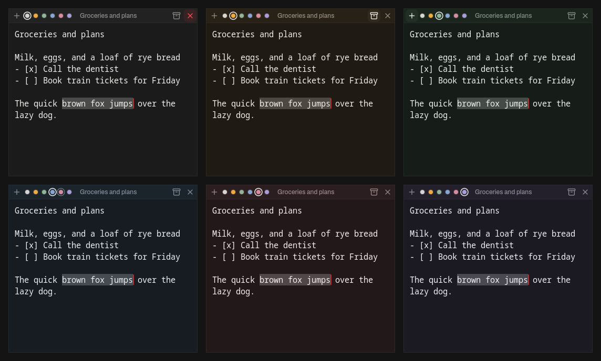
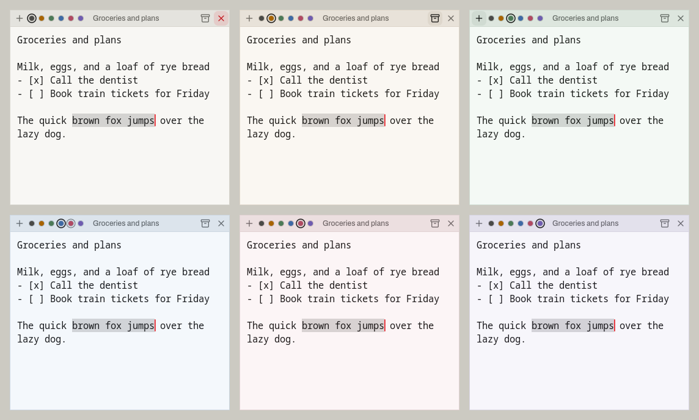
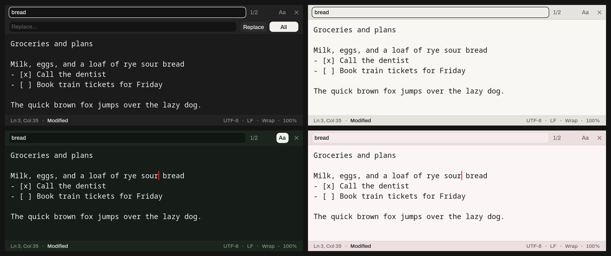
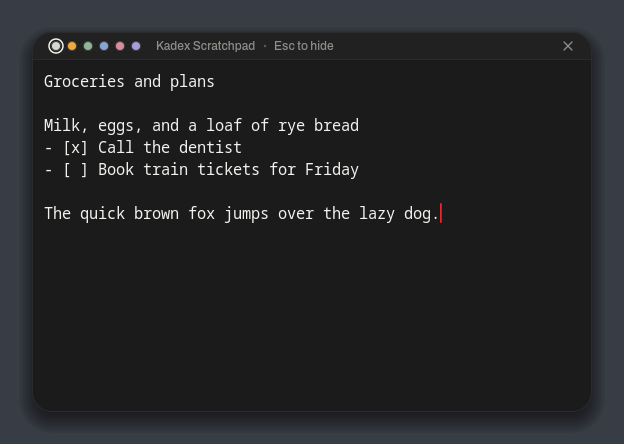

<p align="center">
  
</p>

<p align="center">
  
  
  
  
  <a href="LICENSE"></a>
</p>

<p align="center">
  <a href="#screenshots">Screenshots</a> ·
  <a href="#features">Features</a> ·
  <a href="#measured-footprint-linux--cachyos--niri">Footprint</a> ·
  <a href="#building">Building</a> ·
  <a href="#keyboard-shortcuts">Shortcuts</a> ·
  <a href="#storage-layout">Storage</a> ·
  <a href="PRD.md">PRD</a> ·
  <a href="#license">License</a>
</p>

---

**Kadex** (*Ka* from Karel + *codex*, Latin for notebook) is a single-binary, zero-bloat, native Rust **Notepad & Sticky Notes** app built for **Linux (Wayland / Niri)** and **Windows**.

No Electron. No WebView2. No XWayland. No GPU context. Pure native OS rendering with a shared zero-dependency Rust core.

---

## Screenshots

<p align="center">
  
</p>

<p align="center">
  
</p>

<table>
  <tr>
    <td width="62%"></td>
    <td width="38%"></td>
  </tr>
  <tr>
    <td align="center">File mode: find &amp; replace, status bar</td>
    <td align="center">Overlay scratchpad</td>
  </tr>
</table>

<sub>Rendered offscreen by Kadex's own Cairo/Pango drawing code (<code>KADEX_SNAPSHOT_DIR=out cargo test -p kadex-platform-wl snapshots</code>).</sub>

---

## Measured Footprint (Linux / CachyOS + Niri)

Measured live on CachyOS + Niri (`WAYLAND_DISPLAY=wayland-1`, zero XWayland):

| Metric | Measured | PRD Target |
| :--- | :--- | :--- |
| **Private Dirty RAM (1 sticky note)** | **5.0 MB** (`4.3 MB` anon) | ≤ 10 MB *(stretch ≤ 5 MB)* |
| **Private Dirty RAM (5 sticky notes)** | **12.6 MB** *(untiled)* / **~9 MB** *(360×320 floating)* | ≤ 16 MB |
| **Cold Start to Ready** | **21 ms** | < 25 ms |
| **IPC `kadex toggle` Latency** | **14 ms** | < 15 ms |
| **Idle CPU Usage** | **0.0%** (`0` ticks / sec in `poll()`) | 0.0% |
| **Binary Size (stable Rust, stripped)** | **~517 KB** *(incl. ~24 KB embedded UI font; ~170 KB with nightly `-Z build-std` before the font was added)* | ≤ 350 KB / ≤ 200 KB |

---

## Features

- **Dual Mode:**
  - **Sticky Mode** (`app_id: kadex.sticky`): Compact 28 px header bar with 6 curated dark/light palettes, lucide-style icon buttons (new note, archive, pin on Windows, hide), the note's first line as title, drag-to-move, and crash-safe debounced auto-save (500 ms + immediate flush on focus loss and `SIGTERM`/`SIGINT`/`WM_ENDSESSION`).
  - **File Mode** (`app_id: kadex.editor`): Tiles natively in Niri columns (respects `prefer-no-csd`), preserves UTF-8 / UTF-8 BOM / UTF-16 LE/BE and `LF`/`CRLF`, dirty `*` title indicator, and bottom status bar (`Ln/Col`, encoding, EOL, wrap, zoom).
  - **Overlay Scratchpad** (`kadex overlay`): Centered Wayland `zwlr_layer_shell_v1` top-layer scratchpad floating above all Niri workspaces, drawn as a rounded panel with a soft shadow; dismisses on `Esc`.
- **Editor Essentials:**
  - Full Unicode / UTF-8 + IME (`zwp_text_input_v3`), multi-level Undo/Redo (`Ctrl+Z`/`Ctrl+Y`), Find & Replace (`Ctrl+F`/`Ctrl+H`, `F3`/`Shift+F3`), Word Wrap (`Alt+Z`), Font Zoom (`Ctrl+=`/`-`/`0` & `Ctrl+Wheel`), Clipboard + Wayland Primary Selection (middle-click paste), Per-Monitor Fractional DPI (`wp_fractional_scale_v1` + `wp_viewporter` / Win32 DPI v2), Markdown checkbox toggle (`Ctrl+Enter` toggles `- [ ] ` ↔ `- [x] `).
  - Smooth handling of large (5 MB+) `.log` files via windowed viewport slicing.
- **Portable Mode:** Drop an empty `portable.ini` next to the `kadex` binary to store `config.ini`, `state.ini`, and `notes/` beside the executable.

---

## Design

Kadex shares its look with [Kavox](https://github.com/Aitemaa/Kavox) and [Kapix](https://github.com/Aitemaa/Kapix): warm neutral grays, a 1 px hairline instead of heavy chrome, lucide-style stroked icons on a 24 grid, a red accent (the caret, the danger hover) and [Archivo](https://github.com/Omnibus-Type/Archivo) Medium for the interface text.

- **Palettes:** six, each in a dark and a light variant, selectable from the dots in the sticky header: **Graphite** (the Kavox neutrals verbatim), **Amber**, **Sage**, **Cobalt**, **Rose** and **Iris** (the same lightness steps with a faint hue wash, so text contrast is identical in every palette).
- **Text:** your note text keeps the font from `config.ini` (`font_family`, `font_size`; monospace by default, Consolas on Windows). Only the chrome (header title, find bar, status bar) uses Archivo.
- **Caret and selection:** the text caret is Kavox red in every palette; the selection is the palette's `lit` colour at low alpha.
- **Windows:** the title bar follows the theme (dark mode, plus caption and border colours on Windows 11). RichEdit offers no API for the caret or selection colour, so those stay the system's.

---

## CLI & IPC Commands

```sh
kadex                  # Show sticky notes (or create one)
kadex path/to/file.txt # Open a file in File Mode
kadex new              # Spawn a new sticky note
kadex toggle           # Show / hide all sticky notes
kadex hide             # Hide all sticky notes
kadex list             # Print `id<TAB>first line` (pipe into fuzzel/rofi)
kadex open <id>        # Open / focus a sticky note by ID
kadex overlay          # Toggle layer-shell overlay scratchpad
kadex quit             # Flush all notes atomically and stop daemon
```

---

## Niri Integration

See [`packaging/niri/kadex.kdl`](packaging/niri/kadex.kdl):

```kdl
window-rule {
    match app-id=r#"^kadex\.sticky$"#
    open-floating true
    default-column-width { fixed 360; }
    default-window-height { fixed 320; }
    opacity 0.96
}

window-rule {
    match app-id=r#"^kadex\.editor$"#
    open-floating false
}

binds {
    Mod+Shift+N { spawn "kadex" "toggle"; }
    Mod+Alt+N   { spawn "kadex" "new"; }
    Mod+Ctrl+N  { spawn "kadex" "overlay"; }
    Mod+Shift+K { spawn "sh" "-c" "id=$(kadex list | fuzzel --dmenu --prompt='Kadex> ' | cut -f1); [ -n \"$id\" ] && kadex open \"$id\""; }
}
```

---

## Building

### Linux (Arch / CachyOS)

Dependencies (already installed on standard Wayland desktops):
`wayland`, `libxkbcommon`, `pango`, `cairo`, `glib2`, `pkgconf`, `rust`

```sh
cargo build --release
# Binary: target/release/kadex
```

Ultra-lean binary (~170 KB) using nightly `build-std`:
```sh
cargo +nightly build --release \
  -Z build-std=std,panic_abort \
  -Z build-std-features=panic_immediate_abort \
  --target x86_64-unknown-linux-gnu
```

Or build an Arch/CachyOS package:
```sh
cd packaging/arch && makepkg -si
```

### Windows

Download `kadex-<version>-windows-x64-setup.exe` from the [Releases](https://github.com/Aitemaa/Kadex/releases) page and run it. No admin rights are needed: it installs for your user into `%LOCALAPPDATA%\Programs\Kadex`. Choose "for all users" on the first page to install into Program Files instead. It adds:

- a Start menu entry, so Kadex shows up in Windows search
- optional: a desktop shortcut, starting at sign-in (keeps `Ctrl+Alt+N` ready), and an "Open with" entry for `.txt`, `.md`, and `.log` files
- an uninstaller in **Settings → Apps**. Uninstalling never deletes your notes in `%APPDATA%\kadex`.

The plain `kadex.exe` and a portable zip are attached to each release as well. To build it yourself:

```sh
cargo build --release --target x86_64-pc-windows-msvc
```

---

## Keyboard Shortcuts

| Shortcut | Action |
| :--- | :--- |
| `Ctrl+N` | New sticky note |
| `Ctrl+S` | Save file / flush sticky note immediately |
| `Ctrl+W` | Hide sticky note / close file window |
| `Ctrl+F` / `Ctrl+H` | Find / Find & Replace |
| `F3` / `Shift+F3` | Next / Previous match |
| `Alt+Z` | Toggle word wrap |
| `Ctrl+=` / `Ctrl+-` / `Ctrl+0` | Zoom in / out / reset *(or `Ctrl+Wheel`)* |
| `Ctrl+Enter` | Toggle markdown checkbox (`- [ ] ` ↔ `- [x] `) |
| `Ctrl+T` *(Windows)* | Toggle always-on-top pin |
| `Esc` | Close Find bar / dismiss Overlay scratchpad |

---

## Storage Layout

| Purpose | Linux (XDG) | Windows |
| :--- | :--- | :--- |
| Config | `$XDG_CONFIG_HOME/kadex/config.ini` | `%APPDATA%\kadex\config.ini` |
| Notes | `$XDG_DATA_HOME/kadex/notes/*.txt` | `%APPDATA%\kadex\notes\*.txt` |
| Archive | `$XDG_DATA_HOME/kadex/notes/archive/` | `%APPDATA%\kadex\notes\archive\` |
| State | `$XDG_STATE_HOME/kadex/state.ini` | `%APPDATA%\kadex\state.ini` |
| IPC | `$XDG_RUNTIME_DIR/kadex.sock` | Named Mutex + `WM_COPYDATA` |

---

## License

MIT — Ignatius Karel

### Third-party

The interface font **Archivo** (Latin subset of `Archivo-Medium.ttf`, embedded in the binary and loaded privately at runtime, never installed) is © The Archivo Project Authors and licensed under the [SIL Open Font License 1.1](assets/fonts/OFL.txt).
